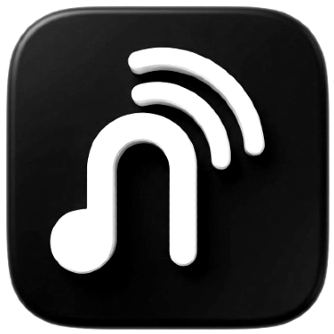
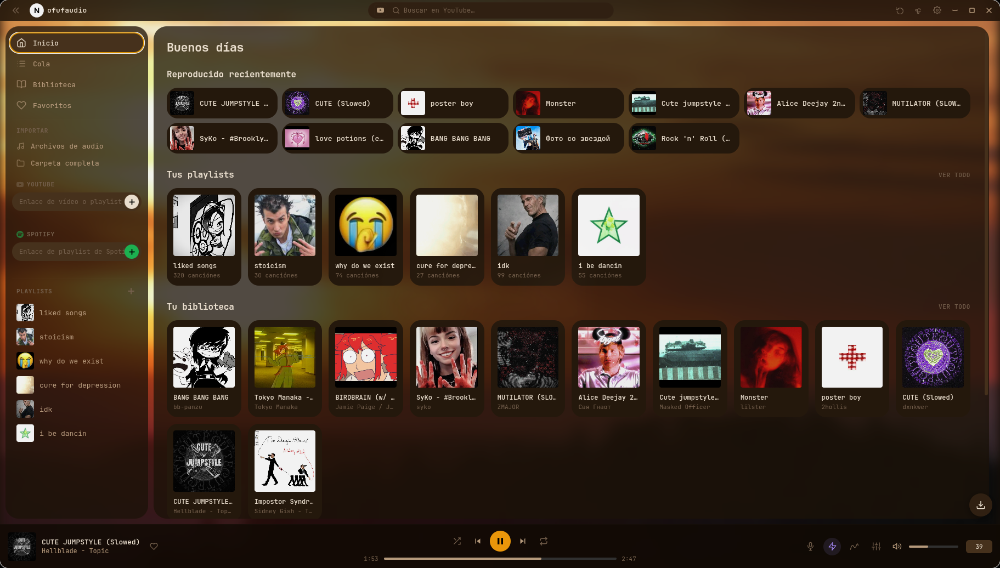
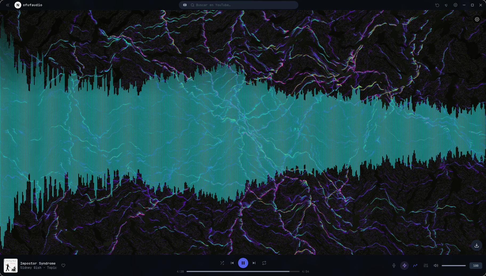
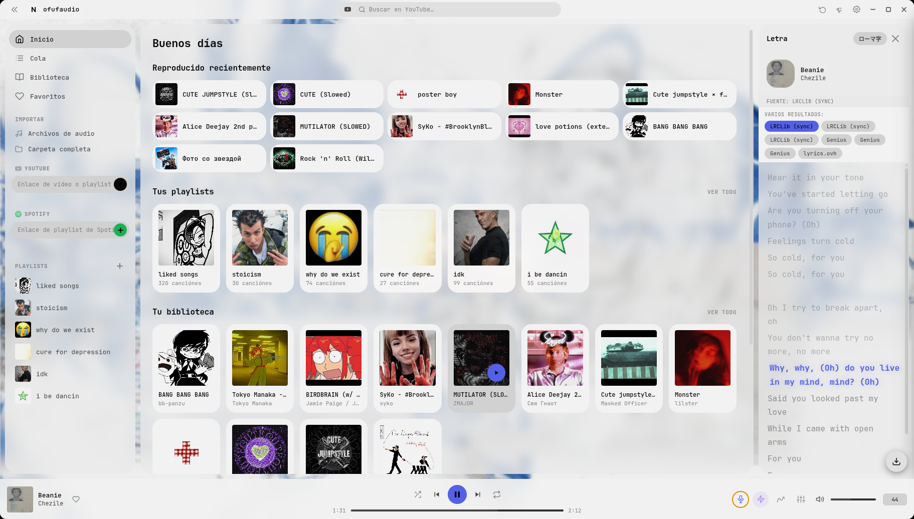
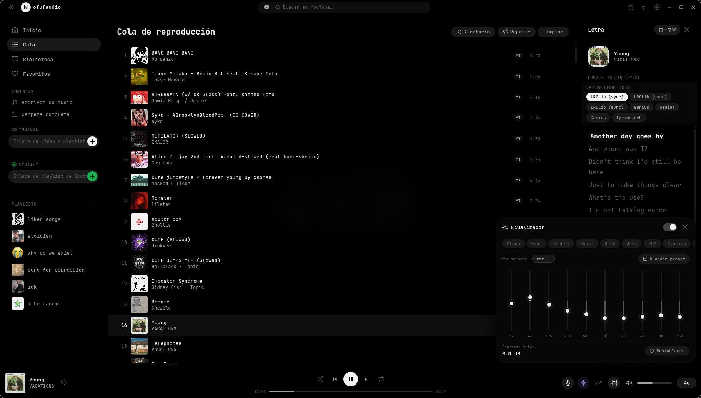

<div align="center">



# NofufAudio

**Hybrid, open-source music player for YouTube, Spotify and local files**

[](LICENSE)
[]()
[](https://www.electronjs.org/)

</div>

---

NofufAudio is a desktop music player that combines YouTube streaming, Spotify playlist importing, and local file playback in a single, clean interface. No subscriptions. No ads. Everything stays local.

---

## 📸 Screenshots

<div align="center">
  
  
  
  
</div>

## ✨ Features

### 🎵 Playback
- Play audio from **YouTube** (videos and playlists) directly — audio only, no video
- Play **local files**: MP3, FLAC, OGG, WAV, M4A, OPUS and more
- **Persistent queue** with shuffle and repeat (song / all)
- **Crossfade** between songs (configurable from 1 to 10 seconds)
- **Volume normalization** to even out louder and quieter songs
- Integration with **media keys** and the OS media session (lock screen controls, album art)

### 📥 Import
| Source | What you can import |
|---|---|
| **Local files** | Individual files or entire folders — metadata and cover art are read automatically |
| **YouTube URL** | Paste any video URL to add it to your library instantly |
| **YouTube playlist** | Paste a playlist URL — every song is imported with thumbnails |
| **Spotify playlist** | Paste a Spotify playlist URL — NofufAudio automatically finds the matching YouTube audio for each song |

### 🔍 Search
- Built-in **YouTube search** — find any song or video without leaving the app
- **Spotify catalog search** — search songs by name and add them to your library

### 💾 Download
- Download any **individual song** (from YouTube or local) to disk as MP3, M4A, OPUS or WEBM
- Download an **entire playlist** at once — resumes where you left off if you cancel
- Configurable **output folder** and **format** per session
- Real-time **download progress** panel with per-song status

### 📋 Library and Playlists
- Full **library** view with search and sorting
- Unlimited **custom playlists** — configurable name, cover, and song order
- **Favorites** system (heart button on any song)
- **Recently played** shelf on the home screen
- **Context menu** (right-click) on any song: edit info, add to playlist, play next, download, mark as favorite

### 🎛️ Audio effects — Nightcore panel
Dedicated effects panel with four presets and full manual control:

| Control | Range | What it does |
|---|---|---|
| **Reverb** | 0% – 100% | Adds reverberation to your music |
| **Pitch** | −12 to +12 st | Raises or lowers the pitch independently of speed |
| **Treble boost** | adjustable | Adds the characteristic nightcore brightness |

Built-in presets: **Nightcore**, **Slowed**, **Vaporwave**, **Speed Up**

### 🎚️ Equalizer
- 10-band parametric EQ
- Built-in presets: Flat, Bass Boost, Treble Boost, Vocal, Electronic, Acoustic…
- Save and name your own **custom presets** (persist across sessions)
- Can be enabled/disabled without losing the settings

### 📊 Visualizer
- Full-screen audio visualizer (bars, wave, circle)
- Configurable color, sensitivity, shadow, and style
- Opens with one click, closes with the logo or the back button

### 🎤 Lyrics
- Automatic fetching of **synced lyrics** (karaoke-style, word-by-word highlighting)
- Falls back to unsynced lyrics
- Resizable lyrics panel with configurable font and size
- Romanization available for Japanese lyrics
 
### 🎨 Customization
Every visual aspect is adjustable from the theme panel:
- **Color theme** — 8 built-in presets (Dark, AMOLED, Midnight, Forest, Ocean, Rose, Light, Coffee) plus a full color picker for every UI element
- **Accent color** — quick selection or custom hex
- **Font family** — choose from the app's built-in fonts or any font installed on your system
- **Font size**, **border radius**, **border opacity**
- **Panel spacing**, **player height**, **modal background opacity**
- Export and import themes as JSON to share them

### 🖥️ System integration
- **Minimize to tray** and **close to tray** (configurable)
- System tray icon with context menu (Play/Pause, Next, Show, Quit)
- Support for a **background image** in the player
- Frameless window with a custom title bar

---

## 🚀 Installation

### Linux (Arch / CachyOS)

```bash
# 1. Download and extract the zip
unzip linux-portable-nofufaudio.zip
cd nofufaudio

# 2. Run the installer (no sudo needed — installs to ~/.local)
chmod +x install.sh
./install.sh
```

The installer takes care of:
- Checking for Node.js, Python and pip
- Running `npm install` automatically
- Downloading the latest `yt-dlp` binary for your architecture
- Installing `spotifyscraper` (needed to import Spotify playlists)
- Creating the `nofufaudio` command in `~/.local/bin`
- Registering the app in the desktop applications menu

To uninstall:
```bash
bash ~/.local/share/nofufaudio/install.sh --remove
```

### Windows

Simply launch **NofufAudio.exe** from the portable version.

---

## 📦 Dependencies

| Dependency | Needed for |
|---|---|
| **Node.js ≥ 18** | Running the app |
| **yt-dlp** | YouTube streaming and downloading (the installer downloads it automatically) |
| **Python 3** | Importing Spotify playlists |
| **spotifyscraper** (pip) | Importing Spotify playlists |
| **music-metadata** (npm) | Reading metadata from local audio files |

---

<br>

